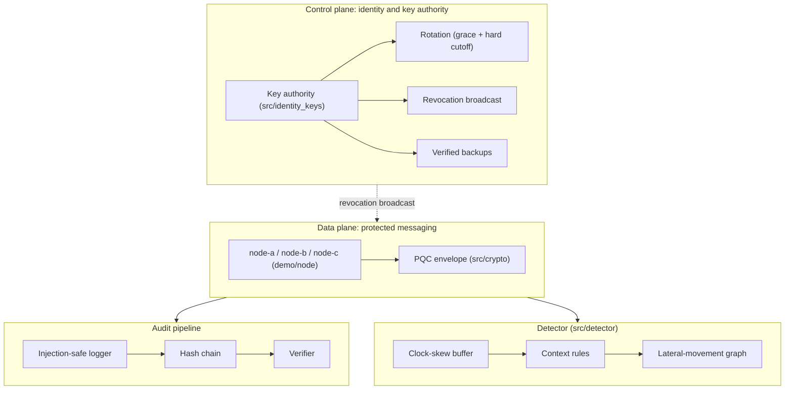

# Trust-But-Verify

Post-quantum protected messaging, key lifecycle management, tamper-evident audit logging and explainable lateral-movement detection for multi-node services. Built for Track 4, "Trust, but verify".

[](LICENSE)

## What it does

1. **Hybrid post-quantum messaging.** Envelopes use ML-KEM-768 (FIPS 203) + X25519 for key establishment, ML-DSA-65 (FIPS 204) for signatures, AES-256-GCM for encryption and HKDF-SHA256 for key derivation. Suite string: `ML-KEM-768+X25519+ML-DSA-65+AES-256-GCM+HKDF-SHA256/v1` (`src/crypto/primitives.py`). Algorithms come from `pqcrypto==1.0.0` and `cryptography`; there are no custom primitives.
2. **Recipient binding and replay protection.** Sender, recipient, session, message ID, counter and epoch are authenticated as AAD. The receiver rejects duplicates and changed recipient information.
3. **Key lifecycle.** Rotation with a configurable grace period and a hard cutoff, cross-node revocation, device re-enrolment, crash recovery and verified backups.
4. **Tamper-evident audit log.** Hash-chained events, injection-safe serialisation and a verifier.
5. **Explainable detection, no AI/ML.** Context rules, a service-access graph and a clock-skew buffer. Every alert names the identity, services, events and the rule or path that fired.

## Architecture



## Setup (clean machine)

Requirements: Linux or macOS (POSIX file locking is required), Python 3.11+, and Node.js on `PATH` (the AEAD helper `src/crypto/node_aead.cjs` uses only Node built-ins). Docker is optional and only needed for `make up`.

```bash
python3 -m venv .venv
source .venv/bin/activate
pip install -r requirements.txt

# Full test suite
python3 -m pytest tests/ -v
```

Make shortcuts: `make setup` (pip install), `make test`, `make chaos`, `make bench`, `make demo`, `make up` / `make down` (Docker sandbox), `make clean`.

Dependencies and licences are pinned in [`requirements.txt`](requirements.txt): `pqcrypto`, `cryptography`, `fastapi`, `starlette`, `uvicorn`, `pydantic`, `jsonschema`, `pytest`, `httpx`, `click`, `requests`, `sqlalchemy`, `alembic`, `psycopg[binary]`. Third-party attributions are in [`ATTRIBUTIONS.md`](ATTRIBUTIONS.md). There are no AI/ML dependencies.

## Demo

```bash
./scripts/run_demo.sh          # boots 3 local nodes and walks through the checklist
python -m src.cli demo-replay
python -m src.cli demo-forward-secrecy
python -m src.cli demo-chunked-loss
python -m src.cli demo-resumption-binding
python -m src.cli verify-logs
python -m src.cli doc-check
```

Operator CLI (run while nodes are up):

```bash
python3 -m demo.node.operator_cli status
python3 -m demo.node.operator_cli rotate --identity node-a
python3 -m demo.node.operator_cli revoke --identity node-a --key-id <KEY_ID> --reason "compromised"
python3 -m demo.node.operator_cli verify-logs
python3 -m demo.node.operator_cli alerts
```

`make demo` generates fresh credentials and binds its services to loopback. When running demo nodes separately, configure distinct random bearer tokens for each purpose:

- `DEMO_OPERATOR_TOKEN` authorizes key rotation and revocation. Set the same token in the CLI's environment when targeting that node. Successful actions are logged as `demo-operator`.
- `DEMO_PEER_ENROLL_TOKEN` authorizes registration of a trusted `GET /keys/public` bundle with `POST /peers`. Refresh the bundle after recipient key rotation.
- `DEMO_RECIPIENT_TOKEN` authorizes reads from that node's `GET /inbox/{receipt_id}`. Use a different recipient token for each node. `POST /receive` verifies and accepts a signed envelope and returns an opaque receipt, which grants no read access by itself.
- `DEMO_REVOCATION_SYNC_TOKEN` authorizes only peer revocation updates. Configure it across the trusted nodes when enabling `PEER_NODES`. Use a protected transport for bearer credentials outside loopback.

Keep each node's `DATA_DIR` across restarts. The inbox stores encrypted envelopes and the replay record in one SQLite transaction. A receipt stays readable while its recipient key is active or in grace. Expired and revoked keys make the associated contents unavailable. After restart, re-enroll the sending peer before accepting new messages.

5-minute demo video: **TODO: paste the public link here and in `docs/project_brief.pdf`.**

## Checklist coverage

| Track 4 objective | Code | Tests |
| :-- | :-- | :-- |
| Key rotation | `src/identity_keys/rotation.py` | `tests/test_part2_rotation.py`, `tests/test_fix01_signed_cutoff.py` |
| Revocation across nodes, re-enrolment | `src/identity_keys/revocation.py`, `reenroll.py` | `tests/test_part3_revocation_reenroll.py`, `tests/test_fix07_revocation_heartbeat.py` |
| Crash recovery | `src/identity_keys/rotation.py` | `tests/test_fix02_rotation_durability.py`, `tests/test_lifecycle_chaos.py` |
| Backup integrity | `src/identity_keys/backup.py` | `tests/test_part4_backup.py`, `tests/test_fix05_backup_mldsa.py` |
| Log integrity | `src/audit/` | `tests/test_log_injection.py`, `tests/test_fix06_cli_log_verification.py` |
| Routine vs suspicious activity | `src/detector/rules.py` | `tests/test_detector_eval.py`, `tests/test_forgery_and_inedge_detection.py` |
| Lateral movement | `src/detector/graph_lateral.py` | `tests/test_fix09_lateral_velocity.py` |
| Clock differences | `src/detector/clock_sync.py` | `tests/test_fix10_clock_watermark.py` |
| Replay and recipient binding | `src/crypto/envelope.py`, `replay_cache.py` | `tests/test_replay_binding.py` |
| Forward secrecy | `src/crypto/handshake.py` | `tests/test_forward_secrecy.py` |
| Delivery under loss or reordering | `src/crypto/delivery.py` | `tests/test_delivery.py`, `tests/test_fix11_delivery_hardening.py` |
| Session resumption | `src/crypto/resumption.py` | `tests/test_resumption.py`, `tests/test_fix04_resumption_mldsa.py` |

## Documented parameters

**Key rotation grace period.** A grace period applies. It is set per rotation with `grace_seconds` (default 30 s in `src/identity_keys/api.py`). During the grace window the retiring key is still accepted; once `grace_until` passes it is rejected. `grace_seconds = 0` means an immediate cutoff with no grace. See [`docs/KEY_LIFECYCLE.md`](docs/KEY_LIFECYCLE.md) for the state machine.

**Clock differences.** `ClockSyncBuffer` (`src/detector/clock_sync.py`) accepts up to ±2000 ms of skew by default (`max_skew_ms`). Events beyond that, and events whose order cannot be established, are flagged `order_uncertain` rather than dropped. The skew thresholds are constructor parameters.

**Delivery and replay.** Incomplete chunked messages are discarded after `DEFAULT_DELIVERY_TIMEOUT_SECONDS = 30.0` and logged as `delivery_failed_incomplete`. The replay cache keeps a sliding window of 256 counters per (sender, recipient, session).

**State on disk.** The track-4 adapter keeps sessions, enrolments, revocations and its audit chain under `TRACK4_STATE_DIR` (default: a `track4-local` folder in the system temp directory, which may be cleared; set it to a private durable directory). State files contain private key material and must be protected like secrets. Locking uses `fcntl` and is not distributed across hosts.

## Detection results

`tests/test_detector_eval.py` runs a synthetic labelled set of 125 events (100 routine, 25 attack) and asserts precision, recall and F1 of at least 0.90, zero false alerts, and per-event evaluation under 50 ms. This set is easy to separate, so treat it as a regression check, not as evidence of real-world accuracy.

`role3_logging_detector` includes a small labelled sample (`sample_logs/labelled_events.jsonl`, 6 events) and reports F1, median time to alert and false alerts per 1,000 benign events:

```bash
cd role3_logging_detector
python3 -m unittest discover -s tests -v
python3 -m src.cli evaluate sample_logs/labelled_events.jsonl
```

Time to alert here is the detector's processing time on in-memory events, not end-to-end latency from a live log stream.

## Performance

`make bench` measures cryptographic operation latency and the protected HTTP workflow from send through durable receipt to authenticated inbox read. It also reports detector throughput and Python allocation overhead.

On macOS arm64 with Python 3.15.2 and the pinned dependencies, reusing the envelope schema validator lowered the median HTTP delivery time from **8.24 ms to 5.52 ms** and increased serial throughput from **111.6 to 159.7 deliveries/s**. These are medians from three local in-process runs per configuration, each with 30 warmup messages and 300 measured deliveries. The standalone crypto-only benchmark measured **3.49 ms p50** across 500 envelopes.

Run `python scripts/measure_revocation.py --ci` for 20 authenticated revocations per scenario. It records the time from commit until the last of three nodes explicitly denies the device and until the last node reports a converged sync watermark. The [revocation report](reports/revocation_latency.md) includes the results and the limits of the single-host SQLite setup.

## Documentation

- Threat model: [`docs/threat_model.md`](docs/threat_model.md), [`threat-model.json`](threat-model.json)
- Project brief: [`docs/project_brief.pdf`](docs/project_brief.pdf)
- Key lifecycle: [`docs/KEY_LIFECYCLE.md`](docs/KEY_LIFECYCLE.md); backup trust model: [`docs/BACKUP_TRUST_MODEL.md`](docs/BACKUP_TRUST_MODEL.md)
- Schemas: [`schemas/envelope.schema.json`](schemas/envelope.schema.json), [`schemas/key_state.schema.json`](schemas/key_state.schema.json), [`schemas/audit_event.schema.json`](schemas/audit_event.schema.json)
- Background notes derived from Prof. Alfred Menezes's Cryptography 101 (<https://cryptography101.ca/>), with attribution: [`docs/01-course-provenance.md`](docs/01-course-provenance.md) to [`docs/07-corrections-and-scope.md`](docs/07-corrections-and-scope.md)

## Limitations

- **Compromised endpoints.** Malware that can read live process memory or keys defeats these controls.
- **Long-term key compromise.** Forward secrecy protects completed sessions; it does not stop impersonation after an identity key is stolen.
- **Denial of service.** Volumetric DoS is out of scope.
- **Python memory.** `bytes` objects are immutable, so zeroisation in `src/crypto/handshake.py` is best-effort.
- **Resumption.** `PersistentResumptionStore` is single-node SQLite; tickets are not replicated across nodes.
- **Audit chain.** Verification detects edits when checked against a trusted head, but an attacker who can replace the whole state file and chain can forge a new chain.
- **Single host.** File locks are POSIX-only and not distributed.
- **Detector.** Rules and the access graph are hand-written policies; they will miss attack patterns they do not describe.
