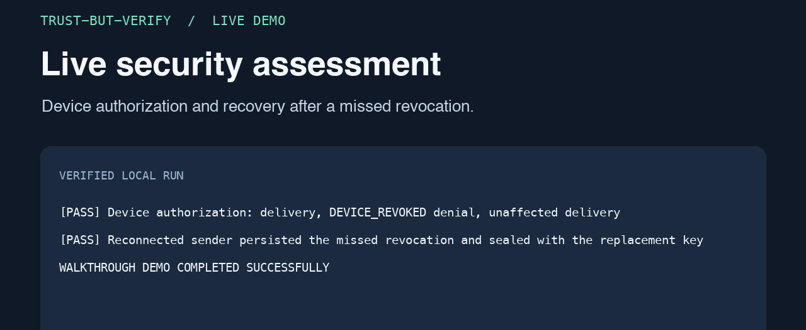
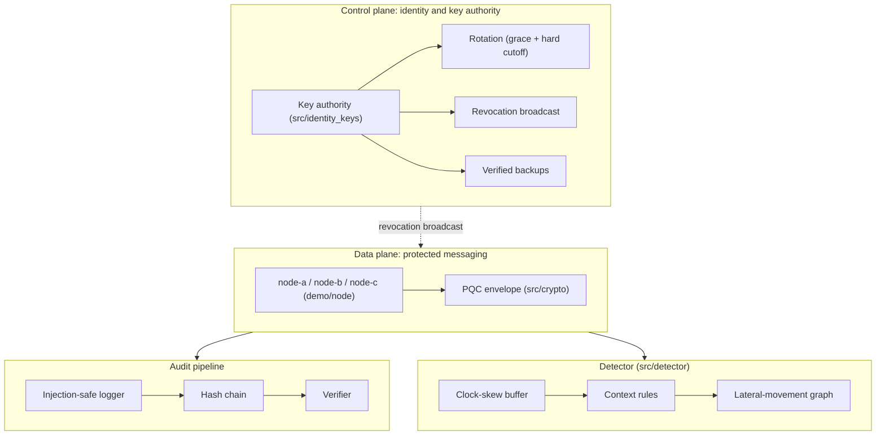

# Trust-But-Verify

Trust-But-Verify protects service-to-service messages with hybrid post-quantum cryptography and verifies that revoked devices lose access while authorized traffic keeps flowing.

[Watch the five-minute walkthrough](docs/demo-walkthrough.mp4) · [Live results](reports/demo_run.md) · [Project brief](docs/project_brief.pdf)

[](docs/demo-walkthrough.mp4)

- **Device revocation:** An enrolled device delivers, its next send returns `DEVICE_REVOKED` after revocation, and a second device still delivers.
- **Reconnect recovery:** A restarted sender learns the revocation it missed, blocks the old key, and seals with the replacement key.
- **Run it locally:** Install the [pinned dependencies](#setup-clean-machine), then run `make demo` for the live flow and all 12 Track 4 checks.

The submission entry points are [the organizer adapter](track4_service.py), [the HTTP demo](scripts/run_demo.sh), and [the test suite](tests/). See the [implementation inventory](docs/DUPLICATES.md) for earlier standalone components.

## What it does

1. **Hybrid post-quantum messaging.** Envelopes use ML-KEM-768 (FIPS 203) + X25519 for key establishment, ML-DSA-65 (FIPS 204) for signatures, AES-256-GCM for encryption and HKDF-SHA256 for key derivation. Suite string: `ML-KEM-768+X25519+ML-DSA-65+AES-256-GCM+HKDF-SHA256/v1` (`src/crypto/primitives.py`). Algorithms come from `pqcrypto==1.0.0` and `cryptography`; there are no custom primitives.
2. **Recipient binding and replay protection.** Sender, recipient, session, message ID, counter and epoch are authenticated as AAD. The receiver rejects duplicates and changed recipient information.
3. **Key lifecycle.** Rotation with a configurable grace period and a hard cutoff, cross-node revocation, device re-enrolment, crash recovery and verified backups.
4. **Tamper-evident audit log.** Hash-chained events, injection-safe serialisation and a verifier.
5. **Explainable detection, no AI/ML.** Context rules, a service-access graph and a clock-skew buffer. Every alert names the identity, services, events and the rule or path that fired.

## Architecture



## Setup (clean machine)

Requirements: Linux or macOS (POSIX file locking is required) and Python 3.11+. The normal transport uses the pinned Python crypto libraries. Install Node.js for the offline crypto fallback and its tests. Docker is optional and only needed for `make up`.

```bash
python3 -m venv .venv
source .venv/bin/activate
pip install -r requirements.txt

# Full test suite
python3 -m pytest tests/ -v
make demo
```

Verified from a fresh virtual environment on macOS arm64 with Python 3.11.18
and Node.js 26.13.1. The full suite passed 262 tests, and the local HTTP demo
passed all 12 checklist objectives. The demo uses localhost ports 8001–8003
and 8005. The remaining Python 3.11 test warning comes from Starlette's
deprecated AnyIO `BlockingPortal` alias. On Python 3.15, FastAPI and Starlette
also warn about their use of `asyncio.iscoroutinefunction`.

Make shortcuts: `make setup` (pip install), `make test`, `make chaos`, `make bench`, `make demo`, `make up` / `make down` (Docker sandbox), `make clean`.

Dependencies and licences are pinned in [`requirements.txt`](requirements.txt): `pqcrypto`, `cryptography`, `fastapi`, `starlette`, `uvicorn`, `pydantic`, `jsonschema`, `pytest`, `httpx`, `click`, `requests`, `sqlalchemy`, `alembic`, `psycopg[binary]`. Third-party attributions are in [`ATTRIBUTIONS.md`](ATTRIBUTIONS.md). There are no AI/ML dependencies.

## Offline adapter

`track4_service.py` uses `cryptography` for state-at-rest HKDF-SHA256 and
AES-256-GCM when it can import it. Without that package, it uses the existing
Node.js worker for both operations and keeps the same serialized state format.
ML-KEM remains in `pqcrypto`. The web stack still uses its pinned dependencies.
Allowed and denied protected reads append audit events and update the local
audit anchor.

### Protected read caller authentication

Configure `TRACK4_ISSUER_PUBLIC_KEY_B64` with the trusted identity issuer's raw 32-byte Ed25519 public key, base64-encoded. Keep the signing key at the issuer. Pass the issuer's signed access token in the JSON field `authorization` as `Bearer <token>`. The adapter checks the signature and token validity before reading state. The verified `user_id` determines ownership. If a read also supplies `actor`, it must match that subject. Configure `TRACK4_ADMIN_SUBJECTS` as a comma-separated list of issuer subject IDs allowed to run `setup`, `revoke`, and `audit`. During setup, asset owners must use the issuer's subject IDs.

The adapter is a stdin CLI. If you expose it through an HTTP service, use TLS at the HTTP boundary and keep its process environment under operator control. For the original offline organizer protocol, set `TRACK4_TRUSTED_HARNESS=1` only in a controlled harness that already verifies caller identity. That setting has no effect when an issuer key is configured. With neither setting, the adapter denies requests. Signed credentials establish the caller as of issuance, and the adapter applies its local subject revocation list on each read.

## Demo

Use `DEMO_GRACE_SECONDS=30 make demo` to exercise a longer cutoff window. The default is two seconds for stage use. Both runs check acceptance and rejection around the cutoff. They run on one host and exercise individual deliveries.

If a live run is unavailable during judging, run `make demo-recorded` to show the saved evidence or use the [recorded walkthrough](docs/demo-walkthrough.mp4) and [recorded observations](reports/demo_run.md).

```bash
./scripts/run_demo.sh          # boots 3 local nodes and walks through the checklist
python -m src.cli demo-replay
python -m src.cli demo-forward-secrecy
python -m src.cli demo-chunked-loss
python -m src.cli demo-resumption-binding
python -m src.cli verify-logs
python -m src.cli doc-check
```

### Demo access

The interactive HTTP API is mounted only with `DEMO_SANDBOX_ENABLED=1`.
`make demo`, the Compose demo services, Render, and Vercel enable it for their
demo processes. For manually launched instances, set the flag and provision
`DEMO_OPERATOR_TOKEN` with a fresh random value. Set the operator token through
the Vercel project environment; Render generates one for new deployments.
Enter the operator token in the web UI; the page keeps it in memory and the
server never embeds it. The CLI reads the same token from its environment.

| Route | Access decision |
| --- | --- |
| `/api/sandbox/*` | Feature flag and operator bearer required. Actions and state can reveal or change sandbox evidence. |
| `POST /enroll`, `POST /send` | Operator bearer required to enroll an identity or make the node send. |
| `POST /peers` | Dedicated peer-enrollment bearer required to change trusted public-key bindings. |
| `POST /internal/keys/revoke` | Dedicated revocation-sync bearer required for inter-node updates. |
| `GET /logs/verify`, `GET /metrics`, `GET /api/info` | Operator bearer required because they expose audit, detector, or deployment details. The JSON variant of `/` uses the same scope. |
| `POST /receive`, `GET /inbox/{receipt_id}` | Receive checks the enrolled peer's signature and recipient binding; inbox reads require the recipient bearer. |
| `GET /` (HTML), `/health`, `/keys/public` | Public UI shell, health probe, and public key discovery. Public keys must still be enrolled through the authenticated peer route. |
| `POST /internal/test/arm-crash` | Identity API requires sandbox mode and a valid actor bearer. |

5-minute demo video: [Walkthrough video](docs/demo-walkthrough.mp4)

For the final submission, publish the recording at an HTTPS URL accessible without signing in. Set `VIDEO_URL` in `docs/project_brief.md`, rebuild with `python -m scripts.build_submission_brief`, and run `make check-release`. Open the link in a signed-out browser to confirm playback.

See [demo operations and implementation coverage](docs/DEMO_OPERATIONS.md) for the acceptance checklist, credentials, operator commands, and runtime parameters.

## Detection results

[Measured judge evidence](reports/JUDGE_EVIDENCE.md) includes per-node HTTP revocation observations,
local HTTP request-to-alert latency, and the synthetic detector score.

`tests/test_detector_eval.py` runs a synthetic labelled set of 125 events (100 routine, 25 attack) and asserts precision, recall and F1 of at least 0.90, zero false alerts, and per-event evaluation under 50 ms. This set is easy to separate, so treat it as a regression check, not as evidence of real-world accuracy.

The [implementation inventory](docs/DUPLICATES.md) identifies the integrated
entry points and describes the earlier standalone detector. Use the root
checklist and labelled fixture for submission evidence.

## Performance

`make bench` measures cryptographic operation latency and the protected HTTP workflow from send through durable receipt to authenticated inbox read. It also reports detector throughput and Python allocation overhead.

On macOS arm64 with Python 3.15.2, three local in-process HTTP runs with 30 warmup messages and 300 measured deliveries each gave a median-of-runs **6.30 ms p50** and **142.5 serial deliveries/s**. Each delivery includes sealing, receipt persistence, and authenticated inbox read. The separate crypto-only sign/encrypt and verify/decrypt round trip measured **3.52 ms p50** and **283.8 envelopes/s** across 500 envelopes.

Run `python scripts/measure_revocation.py --ci` for 20 authenticated revocations per scenario. It records the time from commit until the last of three nodes explicitly denies the device and until the last node reports a converged sync watermark. The [revocation report](reports/revocation_latency.md) includes the results and the limits of the single-host SQLite setup.

## Submission brief

Install the optional [submission tools](requirements-submission.txt) with
`pip install -r requirements-submission.txt`. Set `VIDEO_URL` at the top of
[the brief source](docs/project_brief.md), then run
`python -m scripts.build_submission_brief` to update both the PDF and this
README's video line. Run `make check` to validate the PDF and README links.
External link validation uses the network.

## Documentation

- Implementation inventory: [`docs/DUPLICATES.md`](docs/DUPLICATES.md)
- Threat model: [`docs/threat_model.md`](docs/threat_model.md), [`threat-model.json`](threat-model.json)
- Project brief: [`docs/project_brief.pdf`](docs/project_brief.pdf)
- Key lifecycle: [`docs/KEY_LIFECYCLE.md`](docs/KEY_LIFECYCLE.md); backup trust model: [`docs/BACKUP_TRUST_MODEL.md`](docs/BACKUP_TRUST_MODEL.md)
- Schemas: [`schemas/envelope.schema.json`](schemas/envelope.schema.json), [`schemas/key_state.schema.json`](schemas/key_state.schema.json), [`schemas/audit_event.schema.json`](schemas/audit_event.schema.json)
- Background notes derived from Prof. Alfred Menezes's Cryptography 101 (<https://cryptography101.ca/>), with attribution: [`docs/01-course-provenance.md`](docs/01-course-provenance.md) to [`docs/07-corrections-and-scope.md`](docs/07-corrections-and-scope.md)

## Limitations

- **Compromised endpoints.** Malware that can read live process memory or keys defeats these controls.
- **Long-term key compromise.** Forward secrecy protects completed sessions; it does not stop impersonation after an identity key is stolen.
- **Denial of service.** Volumetric DoS is out of scope.
- **Python memory.** `bytes` objects are immutable, so zeroisation in `src/crypto/handshake.py` is best-effort.
- **Resumption.** `PersistentResumptionStore` is single-node SQLite; tickets are not replicated across nodes.
- **Audit chain.** To check for truncation or replacement, export a verified head with `python verify_log.py --log audit.log --public-key-file checkpoint_pub.b64 --print-anchor > trusted-head.json`, retain that file independently of the log host, then verify against it with `python verify_log.py --log audit.log --public-key-file checkpoint_pub.b64 --anchor-file trusted-head.json`. The application does not publish anchors to an external service.
- **Single host.** File locks are POSIX-only and not distributed.
- **Detector.** Rules and the access graph are hand-written policies; they will miss attack patterns they do not describe.
