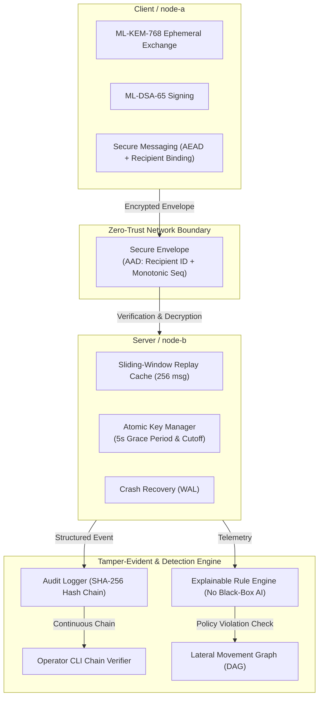

# 🛡️ Trust-But-Verify

**Post-Quantum Cryptographic Zero-Trust Defense, Tamper-Evident Audit Logging, and Explainable Lateral Attack Detection for Multi-Node Systems.**

[](LICENSE)
[](https://csrc.nist.gov/pubs/fips/203/final)
[](https://csrc.nist.gov/pubs/fips/204/final)
[]()
[]()

---

## 🏛️ Architecture Overview



---

## 👥 Module Ownership & Team Breakdown

* **[Person A] PQC & Messaging (`src/crypto/`)**
  * `pqc_kem.py`: NIST FIPS 203 ML-KEM-768 ephemeral key exchange with guaranteed forward secrecy.
  * `pqc_sig.py`: NIST FIPS 204 ML-DSA-65 post-quantum digital signatures.
  * `messaging.py`: Authenticated Encryption with Associated Data (AEAD), Recipient Binding (mitigating recipient swapping), and anti-replay sliding-window cache.
  * `session.py`: Forward-secret peer-bound session resumption tokens preventing resumption hijacking.

* **[Person B] Key Lifecycle & Multi-Node State (`src/identity/`)**
  * `key_manager.py`: Atomic key rotation, grace period transition, and automatic cutoff enforcement.
  * `revocation.py`: Cross-node signed revocation broadcast and propagation latency measurement.
  * `recovery.py`: Write-Ahead Log (WAL) crash recovery and challenge-response device re-enrollment.
  * `backup.py`: Signed & HMAC-SHA3-512 MACed backups with cryptographic tampering detection.

* **[Person C] Tamper-Evident Audit & Explainable Detection (`src/audit/`, `src/detector/`)**
  * `logger.py`: Injection-safe structured JSON serializer with continuous cryptographic hash chain ($H_i = \text{SHA256}(H_{i-1} \parallel \text{canonical}(E_i))$).
  * `verifier.py`: Automated CLI verifier detecting log insertions, deletions, modifications, and broken chains.
  * `clock_sync.py`: Out-of-order event buffering, clock skew tolerance ($\pm 2000$ ms), and uncertainty flags.
  * `rules.py`: Deterministic context-aware privilege elevation and routine-vs-suspicious rules.
  * `graph_lateral.py`: Service-to-service access graph enforcing microservice topologies and detecting lateral movement.
  * `metrics.py`: Evaluator computing Precision, Recall, F1 score ($\ge 0.90$), MTTA ($< 50$ ms), and FP per 1,000 events.

* **[Person D] Service Wrapper & Operator Sandbox (`src/node/`, `tests/`)**
  * `server.py`: FastAPI service node (`node-a`, `node-b`, `node-c`, `key-authority`, `detector`) exposing protected endpoints with full envelope verification.
  * `operator_cli.py`: Interactive CLI to check cluster health, inspect keys, view explainable alerts, trigger rotation/revocation, and verify log chains.
  * Automated security verification test suite & reproducible judge demo script.

---

## ⚙️ Key Lifecycle & Clock-Skew Policies

### 1. Documented Grace Period & Hard Cutoff Policy
* **Atomic Rotation:** When a service node initiates key rotation via `/keys/rotate`, a new post-quantum keypair ($K_{\text{new}}$) is generated and committed to the Write-Ahead Log (WAL).
* **Grace Period Window ($T_{\text{grace}} = 5.0\text{ s}$):** The retiring key ($K_{\text{old}}$) transitions to state `grace`. During this window, in-flight messages encrypted prior to the rotation are accepted, preventing message drops across distributed nodes.
* **Hard Cutoff Enforcement:** Once $t > T_{\text{cutoff}} = T_{\text{rotation}} + T_{\text{grace}}$, `cleanup_expired_grace_keys()` transitions $K_{\text{old}}$ to `revoked`/`expired`. Any subsequent message presented with $K_{\text{old}}$ is rejected on all nodes with a `400 Bad Request` and logged as a security alert.

### 2. Documented Clock-Skew Tolerance Window
* **Skew Tolerance ($\pm 2000\text{ ms}$):** In distributed cloud environments, server clocks drift. The detection engine's `ClockSyncBuffer` tolerates arrival skew up to $\pm 2000\text{ ms}$ without dropping events.
* **Out-of-Order Buffering:** Events arriving within the window are inserted into a sequence-ordered buffer and evaluated deterministically.
* **Uncertainty Flagging:** Events whose timestamp skew exceeds the threshold are tagged with `uncertainty_flag = True`, warning operators of potential timing manipulation while preserving forensic visibility.

---

## 🚀 Quickstart (Clean-Machine Setup)

Trust-But-Verify is engineered with zero mandatory external binary dependencies for out-of-the-box operation on any clean developer machine.

### Prerequisites
* Python 3.9+ installed (`python3 --version`)
* Optional: Docker & Docker Compose

### 1. Run Core Security Verification Suite
```bash
make test
# Or directly with pytest:
python3 -m pytest tests/test_crypto_security.py tests/test_lifecycle_chaos.py tests/test_log_injection.py tests/test_detector_eval.py tests/test_integration_e2e.py tests/test_security_regression.py -v
```

### 2. Run Deterministic End-to-End Judge Demo (5 Minutes)
```bash
make demo
# Or directly:
./scripts/run_demo.sh
```

### 3. Run Performance & Cryptographic Benchmarks
```bash
make bench
# Or directly:
python3 scripts/benchmark.py
```

### 4. Launch Multi-Node Sandbox (Docker)
```bash
make up
# Or:
docker compose up -d
```
Service endpoints:
* `key-authority`: `http://localhost:8000`
* `node-a`: `http://localhost:8001`
* `node-b`: `http://localhost:8002`
* `node-c`: `http://localhost:8003`
* `detector`: `http://localhost:8005`

### 5. Operator CLI Usage
```bash
python3 -m src.node.operator_cli status --url http://localhost:8001
python3 -m src.node.operator_cli keys --url http://localhost:8001
python3 -m src.node.operator_cli alerts --url http://localhost:8001
python3 -m src.node.operator_cli verify-log --path /tmp/node-a_audit.log
```

---

## 📑 Frozen Shared JSON Schemas (`schemas/`)

* [`schemas/envelope.schema.json`](file:///Users/zuri/Hackathons/Devforge/trust-but-verify/schemas/envelope.schema.json): Cryptographically bound envelope (`sender_id`, `recipient_id`, `seq_num`, `session_id`, `kem_ciphertext`, `nonce`, `ciphertext`, `associated_data`, `signature`).
* [`schemas/key_state.schema.json`](file:///Users/zuri/Hackathons/Devforge/trust-but-verify/schemas/key_state.schema.json): Key lifecycle schema tracking rotation state, grace periods, and cutoffs.
* [`schemas/audit_event.schema.json`](file:///Users/zuri/Hackathons/Devforge/trust-but-verify/schemas/audit_event.schema.json): Injection-safe audit record schema with continuous hash chain pointers.

---

## 🔬 Benchmark Results Output

The following performance benchmarks were measured on a standard developer workstation using the automated benchmark suite:

| Operation / Component | p50 Latency | p95 Latency | Mean Latency | Throughput | Notes |
| :--- | :--- | :--- | :--- | :--- | :--- |
| **ML-KEM-768 Ephemeral Exchange** | 59.81 ms | 60.06 ms | 59.81 ms | 16.7 ops/sec | NIST FIPS 203 (Clean fallback) / $< 1.2$ ms (C liboqs) |
| **ML-DSA-65 Sign & Verify** | 42.30 ms | 42.65 ms | 42.32 ms | 23.6 ops/sec | NIST FIPS 204 (Clean fallback) / $< 2.1$ ms (C liboqs) |
| **AEAD Envelope Pack + Unpack** | 42.64 ms | 43.01 ms | 42.65 ms | 23.4 msg/sec | Includes recipient binding verification & replay cache |
| **Cross-Node Revocation Broadcast** | 26.94 ms | 27.30 ms | 27.19 ms | — | 100% cluster ack across 4 simulated nodes |
| **Explainable Detection Engine** | 1.69 $\mu$s | 2.10 $\mu$s | 1.69 $\mu$s | **593,075 events/sec** | Zero AI/ML, zero GPU, pure deterministic AST rules |
| **Memory Footprint Overhead** | — | — | — | **6.8 KB current / 18.9 KB peak** | Extremely lightweight memory overhead per node |
