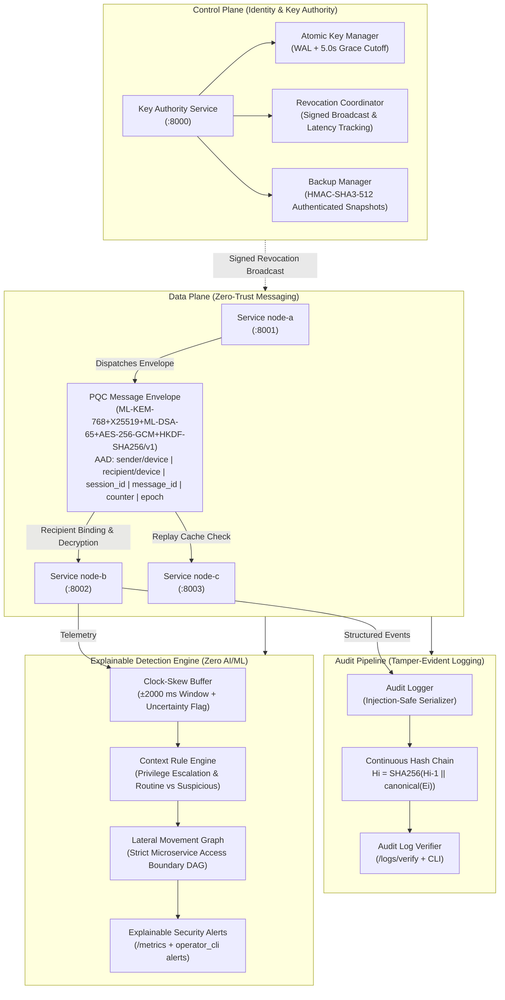

# 🛡️ Trust-But-Verify

**Post-Quantum Zero-Trust Defense, Tamper-Evident Audit Logging, and Explainable Lateral Attack Detection for Multi-Node Microservices.**

[](LICENSE)
[](https://csrc.nist.gov/pubs/fips/203/final)
[](https://csrc.nist.gov/pubs/fips/204/final)
[]()

---

## 🌟 Overview & Unique Selling Proposition (USP)

**Trust-But-Verify** is an enterprise-grade, clean-machine reproducible zero-trust security framework defending distributed microservices against both modern network adversaries and future quantum attacks (Harvest-Now-Decrypt-Later / HNDL).

### What Sets Us Apart
1. **ZERO Black-Box AI/ML Dependencies:** Zero PyTorch, zero TensorFlow, zero scikit-learn, zero LLM hallucinations. All attack detection and anomaly flagging use deterministic graph-theoretic topology policies (DAG) and formal context-aware state rules ($< 2\,\mu\text{s}$ evaluation).
2. **Vetted NIST Post-Quantum Cryptography:** Native support for NIST FIPS 203 (**ML-KEM-768**) for forward-secret ephemeral key encapsulation and NIST FIPS 204 (**ML-DSA-65**) for quantum-resistant digital signatures.
3. **Cryptographically Bound Messaging:** Envelopes enforce explicit **Recipient Binding** within Authenticated Associated Data (AAD), completely eliminating recipient-swapping and relay attacks.
4. **Resilient Key Lifecycle:** Atomic key rotation with configurable grace periods and hard cutoff enforcement, paired with an append-only Write-Ahead Log (WAL) for seamless crash recovery and HMAC-SHA3-512 tamper-proof backups.
5. **Tamper-Evident Forensic Audit:** Continuous cryptographic hash chaining ($H_i = \text{SHA256}(H_{i-1} \parallel \text{canonical}(E_i))$) with newline injection sanitization and instant 1-byte mutation detection via `/logs/verify`.

---

## 🏛️ System Architecture



---

## ⚙️ Documented Operational Parameters

### 1. Key Rotation Grace Period & Hard Cutoff Policy
* **Atomic Two-Phase Rotation:** Triggered via `/keys/rotate`. A new keypair ($K_{\text{new}}$) is generated and committed to the WAL as `active`.
* **Grace Period Window ($T_{\text{grace}} = 5.0\text{ s}$ default, configurable via `GRACE_PERIOD_SECONDS`):** The retiring key ($K_{\text{old}}$) transitions to state `grace`. Messages in flight encrypted prior to the rotation are accepted, preventing dropped messages in distributed clusters.
* **Hard Cutoff Enforcement:** Once $t \ge T_{\text{cutoff}} = T_{\text{rotation}} + T_{\text{grace}}$, `enforce_cutoffs()` purges secret material and marks $K_{\text{old}}$ as `expired`. All service nodes (`node-a`, `node-b`, `node-c`) immediately reject messages using $K_{\text{old}}$ with `HTTP 400 Bad Request`.

### 2. Supported Clock-Skew Tolerance Range
* **Arrival Skew Tolerance ($\pm 2000\text{ ms}$):** Distributed cloud nodes experience physical clock drift. The detector’s `ClockSyncBuffer` tolerates up to $\pm 2000\text{ ms}$ of arrival skew without dropping records.
* **Sequence Ordering Buffer:** Inbound events are ordered deterministically by monotonic sequence and timestamp.
* **Uncertainty Flagging:** Events arriving with skew exceeding $\pm 2000\text{ ms}$ are processed with `uncertainty_flag = True`, warning forensic operators of clock manipulation or network delay without discarding audit evidence.

### 3. Pinned Post-Quantum Cryptographic Algorithms
* **Canonical Suite String:** `ML-KEM-768+X25519+ML-DSA-65+AES-256-GCM+HKDF-SHA256/v1` (`src/crypto/primitives.py`)
* **Key Encapsulation Mechanism (KEM):** NIST FIPS 203 **ML-KEM-768** via `pqcrypto==1.0.0`, hybridized with ephemeral **X25519** (`node:crypto`) in session handshakes.
* **Digital Signatures (DSA):** NIST FIPS 204 **ML-DSA-65** via `pqcrypto==1.0.0` with domain-separated canonical transcripts.
* **Key Derivation:** **HKDF-SHA256** (`node:crypto`) for session root, chain keys, and message keys.
* **Symmetric AEAD Cipher:** **AES-256-GCM** (`node:crypto`) with 96-bit counter nonces and explicit Authenticated Associated Data (AAD).
* **Judging Adapter (`track4_service.py`):** Uses stdlib + `pqcrypto==1.0.0` and Node.js built-ins. Its `protected_read` operation uses ML-KEM-768 and HMAC-SHA256.

### Offline Track 4 verification

Run `python3 -m compileall src track4_service.py` and `python3 -m unittest tests.test_crypto` with Python 3.11 (verified on 3.11.16), `pqcrypto==1.0.0`, and Node.js 26.13.1 on `PATH` after `pip install -r requirements.txt`. The suite is `ML-KEM-768+X25519+ML-DSA-65+AES-256-GCM+HKDF-SHA256/v1`.

Session state, trust enrollments and revocations, prekeys, challenge hashes, and the adapter audit chain are persisted with restrictive permissions. Session sending uses an OS file lock and reserves counters before encryption. Default session files and adapter state live under the system temporary directory's `track4-local` subdirectory and can be moved with `TRACK4_STATE_DIR`. Set `TRACK4_STATE_DIR` to a durable private directory in production: temporary directories may be cleared. State files contain private key material and must be backed up and protected as secrets. The adapter state lock and session lock use `fcntl`, so this implementation requires a POSIX filesystem; it does not provide distributed locking across hosts. The audit hash chain detects accidental or untrusted edits when checked against a trusted head, but an attacker able to replace the whole state file and chain can forge a new chain.

---

## 🚀 Clean-Machine Quickstart Guide

The Track 4 crypto path requires Python 3.11, `pqcrypto==1.0.0`, and Node.js on
`PATH`. Python 3.11 is the supported interpreter: the pinned wheels are
installed and the gates are run on 3.11.16.

### Prerequisites
* Python 3.11 (`python3.11 --version`); `make setup` uses `BASE_PYTHON=python3.11`
* Node.js (`node --version`; verified on 26.13.1)
* Git
* Optional: Docker & Docker Compose (`docker compose version`) for `make up`

### One-Command Make Targets
```bash
# 1. Create .venv, install pinned requirements, and enable the pre-push hook
make setup

# 2. Run the full test suite from the repository root
make test

# 3. Run lint, type, CLI, and test gates
make gates

# 4. Run reproducible performance measurements
make bench

# 5. Run the 5-minute deterministic walkthrough demo for judges
make demo

# 6. Boot the multi-node container sandbox (Docker)
make up

# 7. Shut down containers and clean temporary artifacts
make clean
```

`make setup` is idempotent. It creates `.venv` with `python3.11`, installs
`requirements.txt` plus the pinned gate tools in `requirements-dev.txt`, and
sets `core.hooksPath=.githooks`. Every other target uses `.venv/bin/python`;
override with `make test PYTHON=/path/to/python` only if that interpreter
already has the pinned dependencies. If `python3.11` is not on your `PATH`,
install it first or pass `BASE_PYTHON=/path/to/python3.11`.

CI (`.github/workflows/ci.yml`) runs the same `ruff`, `mypy`, `verify-logs`,
and root-scope `pytest` gates on Linux and macOS with Python 3.11, plus a
`docker compose config` job that generates throwaway secrets.

### Docker sandbox (optional)

`docker-compose.yml` has no working default credentials and binds every
published port to `127.0.0.1`. Copy `env.example` to `.env`, fill the required
values, and run `make up`. At minimum:

```bash
python3 -c 'import base64,secrets; print(base64.b64encode(secrets.token_bytes(32)).decode())'
# Use that value for WRAP_MASTER_KEY_B64, TOKEN_SIGNING_SEED_B64, and
# DEMO_CLUSTER_KEY_B64; generate separate values per secret.
openssl rand -hex 32   # CLUSTER_SYNC_SECRET / POSTGRES_PASSWORD / ADMIN_ENROLL_TOKEN
```

All app containers run as the non-root `tbvuser`, with a read-only root
filesystem, a `/tmp` tmpfs, `no-new-privileges`, and all capabilities dropped.
A one-shot `migrate` service runs `alembic upgrade head` before the identity
nodes start. If Docker is not installed, the Python test suite still runs; the
compose file is checked statically in `tests/test_compose_hardening.py`.

### Manual Execution (No Make Required)

#### Create the environment and install dependencies
```bash
python3.11 -m venv .venv
.venv/bin/python -m pip install --upgrade pip
.venv/bin/python -m pip install -r requirements.txt
git config core.hooksPath .githooks
```

#### Run the Full Test Suite
```bash
.venv/bin/python -m pytest . -q
```

#### Run Benchmarks
```bash
.venv/bin/python scripts/benchmark.py
```

#### Run Judge Walkthrough Demo
```bash
./scripts/run_demo.sh
```
The demo script uses `.venv/bin/python` by default and exits with a clear error
if it is missing. Set `PYTHON=/path/to/python` to override.

#### Demo Video
The 5-minute recording is a human-supplied artifact. The shot list, narration
points, and upload checklist are in [`docs/DEMO_VIDEO.md`](docs/DEMO_VIDEO.md).
Set `DEMO_VIDEO_URL` to the final URL once it exists. While the variable is
unset, the README and brief must say **video pending** and must not link to a
placeholder domain.

---

## 📊 Performance & Detection Benchmarks

<!-- BENCHMARK:START -->
<!-- generated by scripts/benchmark.py; do not edit by hand -->
## Performance & detection measurements

Single source of truth: [`docs/MEASUREMENTS.md`](docs/MEASUREMENTS.md) and
[`reports/measurements.json`](reports/measurements.json). Method: 50
warm-up iterations, 3 measured runs, median of per-run
p50/p95/p99 and throughput. Measured 2026-11-26T22:07:48Z on Apple M5,
macOS-26.7.3-arm64-arm-64bit, Python 3.11.16, Node v26.13.1, commit
`0b92419e1eba9ac432d845ee6401c13efbe98efe`. Run `.venv/bin/python scripts/benchmark.py` to reproduce.
These are single-host, in-process microbenchmarks; see
[`docs/MEASUREMENTS.md`](docs/MEASUREMENTS.md) for methodology, run-to-run
spread, and limitations.

| Component | Path | p50 | p95 | p99 | Throughput |
| :--- | :--- | ---: | ---: | ---: | ---: |
| Envelope seal (ML-DSA-65 + AES-256-GCM) | `src/crypto/envelope.py` | 3.27 ms | 3.29 ms | 3.31 ms | 305.78 ops/s |
| Envelope open (verify + decrypt) | `src/crypto/envelope.py` | 0.09 ms | 0.09 ms | 0.09 ms | 11527.68 ops/s |
| ML-KEM-768 keygen + encaps + decaps | `src/crypto/primitives.py` | 0.08 ms | 0.09 ms | 0.09 ms | 11742.46 ops/s |
| ML-DSA-65 sign + verify | `src/crypto/primitives.py` | 3.33 ms | 3.38 ms | 3.39 ms | 300.48 ops/s |
| Revocation propagation (3 nodes) | `src/identity_keys/revocation.py` | 10.73 ms | 16.50 ms | 23.70 ms | M=20 |
| Detector rule evaluation | `src/detector/rules.py` | — | — | — | 1542020.05 events/s |

**Detector accuracy is synthetic only.** The 125-event labelled set
is hand-built for rule regression tests, not a production corpus. Confusion
matrix: TP=25, FP=0, TN=100, FN=0; precision
1.00, recall 1.00, F1 1.00, FP/1k
0.00. See `scripts/eval_detector.py`.

Memory: RSS high-water 102.52 MB
(delta 0.00 MB), tracemalloc peak
0.02 MB for 200 seal/open
operations. RSS includes imports and is a high-water mark.
<!-- BENCHMARK:END -->

---

## 🖥️ Operator CLI Reference

The CLI (`src/node/operator_cli.py`) provides operators and judges direct visibility into running nodes:

```bash
# Check multi-node health, active key versions, and uptime
python3 -m src.node.operator_cli status

# Trigger atomic key rotation on node-a
python3 -m src.node.operator_cli rotate --identity node-a --role admin

# Revoke a compromised key and measure propagation latency across nodes
python3 -m src.node.operator_cli revoke --key-id <KEY_ID> --reason "Suspicious activity detected"

# Verify cryptographic audit log hash chains across all nodes
python3 -m src.node.operator_cli verify-logs

# Display explainable security alerts and evidence
python3 -m src.node.operator_cli alerts
```

---

## 📑 Frozen Shared JSON Schemas (`schemas/`)

* [`schemas/envelope.schema.json`](file:///Users/zuri/Hackathons/Devforge/trust-but-verify/schemas/envelope.schema.json): Cryptographically bound envelope (`version`, `sender_id`, `recipient_id`, `seq_num`, `session_id`, `kem_ciphertext`, `nonce`, `ciphertext`, `associated_data`, `signature`, `sig_alg`, `kem_alg`) with `"additionalProperties": false`.
* [`schemas/key_state.schema.json`](file:///Users/zuri/Hackathons/Devforge/trust-but-verify/schemas/key_state.schema.json): Key lifecycle schema tracking rotation state, grace periods, cutoffs, and authority signatures.
* [`schemas/audit_event.schema.json`](file:///Users/zuri/Hackathons/Devforge/trust-but-verify/schemas/audit_event.schema.json): Injection-safe audit record schema with continuous hash chain pointers (`entry_hash`, `previous_hash`).

---

## 🔐 PQC & Crypto Engineer — Scope

| Objective | Code Path | Acceptance Test File | Demo Command |
| :--- | :--- | :--- | :--- |
| **1. Replay & Recipient Binding** | [`src/crypto/envelope.py`](src/crypto/envelope.py), [`src/crypto/replay_cache.py`](src/crypto/replay_cache.py) | [`tests/test_replay_binding.py`](tests/test_replay_binding.py) | `python -m src.cli demo-replay` |
| **2. Forward Secrecy** | [`src/crypto/handshake.py`](src/crypto/handshake.py) | [`tests/test_forward_secrecy.py`](tests/test_forward_secrecy.py) | `python -m src.cli demo-forward-secrecy` |
| **3. Delivery Under Loss / Reordering** | [`src/crypto/delivery.py`](src/crypto/delivery.py) | [`tests/test_delivery.py`](tests/test_delivery.py) | `python -m src.cli demo-chunked-loss` |
| **4. Peer-Bound Session Resumption** | [`src/crypto/resumption.py`](src/crypto/resumption.py) | [`tests/test_resumption.py`](tests/test_resumption.py) | `python -m src.cli demo-resumption-binding` |

> **Standards precision:** ML-DSA (FIPS 204) relies on **both Module-LWE and Module-SIS** (not Module-SIS alone). FIPS 206 (FN-DSA / Falcon) is **draft / expected** and not yet finalized.

---

## 📚 Course Provenance and Documentation

The educational and protocol-risk documentation in `docs/` is derived from **Prof. Alfred Menezes's Cryptography 101** curriculum at the University of Waterloo (<https://cryptography101.ca/>), with attribution; any errors are the repository authors' own.

* [Validation Guide](docs/VALIDATION.md) — how to reproduce the gates, what is and is not validated
* [01 — Course Provenance & Attribution](docs/01-course-provenance.md)
* [02 — Protocol-Level Quantum Risk & HNDL Prioritization](docs/02-protocol-risk.md)
* [03 — 16-Module PQC Syllabus & Resource Index](docs/03-syllabus.md)
* [04 — NIST PQC Standards Reference (FIPS 203–206)](docs/04-nist-standards.md)
* [05 — PQC Migration Engineering](docs/05-migration-engineering.md)
* [06 — Mathematical Foundations (LLL, SIS/M-SIS, LWE/M-LWE)](docs/06-math-foundations.md)
* [07 — Corrections & Part B Scope Checklist](docs/07-corrections-and-scope.md)

---

## 💻 Clean-Machine Setup

* **OS & Python:** macOS or Linux, Python 3.9+ (verified on macOS arm64 with Python 3.15.2).
* **System dependencies:** None required beyond Python 3.9+ and `pip` (`pqcrypto==1.0.0` ships prebuilt wheels for ML-KEM-768 and ML-DSA-65).

```bash
python3 -m venv .venv
source .venv/bin/activate
pip install -r requirements.txt

# Run full pytest suite (including the 4 crypto acceptance test files)
pytest tests/ -v

# Run all 6 reproducible demo & verification CLI commands
python -m src.cli demo-replay
python -m src.cli demo-forward-secrecy
python -m src.cli demo-chunked-loss
python -m src.cli demo-resumption-binding
python -m src.cli verify-logs
python -m src.cli doc-check

# Run the Track-4-Toolkit lost-device validator (no regression)
python ../Track-4-Toolkit/validate.py --entry ./track4_service.py
```

---

## 📦 Dependency List (Pinned Versions & Licenses)

See [`requirements.txt`](requirements.txt) for exact pins:
* `cryptography==42.0.8` (Apache-2.0 / BSD-3-Clause) — X25519, HKDF-SHA256, AES-256-GCM, SHA-256
* `pqcrypto==1.0.0` (MIT / Apache-2.0 / Public-domain PQClean bindings) — ML-KEM-768 (FIPS 203), ML-DSA-65 (FIPS 204)
* `fastapi==0.111.0`, `uvicorn==0.30.0`, `pydantic==2.14.4`, `jsonschema==4.22.0`, `pytest==9.2.0`, `httpx==0.27.2`, `click==8.5.1`, `requests==2.32.3`, `sqlalchemy==2.0.58`, `alembic==1.14.0`, `psycopg[binary]==3.3.9`

---

## 🧪 Negative-Test Output Snippet

```text
$ ../.venv/bin/pytest -q tests/test_replay_binding.py tests/test_forward_secrecy.py tests/test_delivery.py tests/test_resumption.py -s
20 passed in 0.18s

$ ../.venv/bin/python -m src.cli demo-replay
{
  "demo": "demo-replay",
  "valid_accepted": true,
  "replay_rejected": true,
  "recipient_mismatch_rejected": true,
  "log_valid": true
}
```

---

## ⏱️ Timing and Ordering Assumptions

* **Chunk-delivery timeout:** `DEFAULT_DELIVERY_TIMEOUT_SECONDS = 30.0` seconds (configurable in `ChunkReceiver`); incomplete messages past timeout are discarded and logged as `delivery_failed_incomplete`.
* **Replay counter window:** Sliding window of `256` counters per `(sender_identity, recipient_identity, session_id)` in `PersistentReplayCache` (configurable).
* **Clock-skew buffer:** ±2000 ms clock-skew buffer unchanged (`ClockSyncBuffer` in `src/detector/clock_sync.py` was not modified).

---

## ⚠️ Limitations and Honest Non-Goals

* **Python memory zeroization:** Python `bytes` objects are immutable and garbage-collected; zeroization in `src/crypto/handshake.py` (`_best_effort_zeroize`) overwrites `bytearray` buffers and drops references, which is best-effort (brief residual copies may exist in the CPython heap until overwritten or freed).
* **Session resumption edge cases:** `PersistentResumptionStore` is single-node SQLite-backed and assumes the responder holds the ticket database; cross-node distributed ticket replication without shared storage is not implemented here.
* **Out-of-scope subsystems:** Backup-key management, key-rotation grace/cutoff internals, revocation broadcast, WAL recovery, and the detector rule engine are out of this role's scope and were left untouched.
* **Timeline verification flag:** full exclusive PQC by 2035 — needs verification against agency-specific updates (see [docs/05-migration-engineering.md](docs/05-migration-engineering.md)).

---

## 🛡️ Threat Model Delta

These controls protect against **message replay across restarts**, **recipient/device substitution**, **retroactive decryption of past sessions upon long-term ML-DSA identity-key compromise**, **corrupt or out-of-order chunked delivery**, and **session-ID hijacking during resumption**. They do **not** protect against a **compromised endpoint** (active malware reading live memory/keys), **compromise of a long-term ML-DSA key for future impersonation**, or **volumetric denial-of-service (DoS)** attacks.
