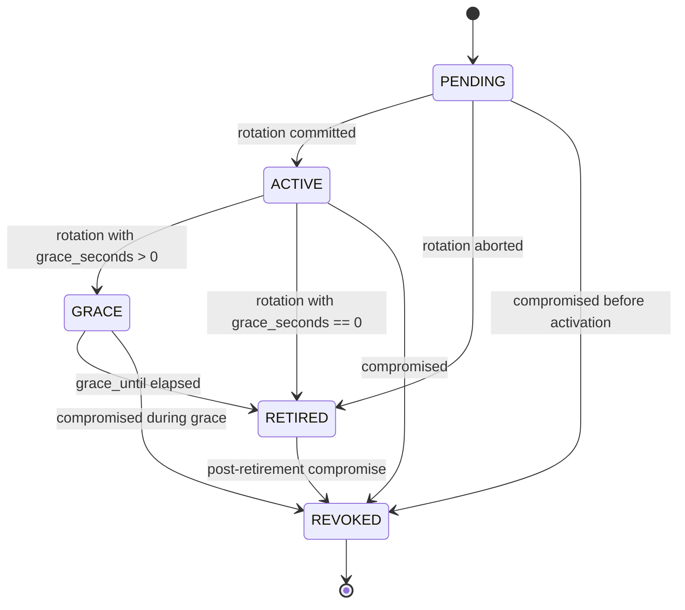
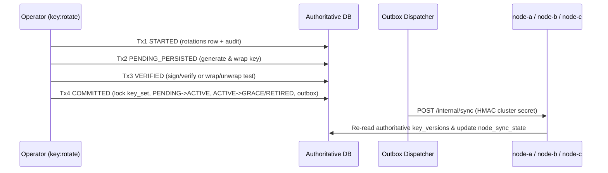

# Key Lifecycle & Rotation Architecture (`docs/KEY_LIFECYCLE.md`)

## 1. Two Kinds of Keys (`auth` vs `data`)

> **Design Principle:** Never confuse retired authentication credentials with historical decryption keys needed to recover authorized data.

| Property | `auth` Key Scope | `data` Key Scope (KEK) |
| --- | --- | --- |
| **Purpose** | Signing / verifying authentication credentials & tokens (Ed25519). | Wrapping per-resource Data Encryption Keys (DEKs, AES-256-GCM). |
| **On `RETIRED`** | **Rejected** for all operations. Wrapped private material is **wiped**; public key retained. | **Decrypt-only**: never used for new wrapping, but wrapped material is **retained** so authorized users can read historical data. |
| **On `REVOKED`** | **Permanently rejected**; cannot authenticate again. | Marked **compromised**: new wrapping forbidden, forced re-wrap required; authorized admin recovery (`admin_recover_rewrap`) can decrypt & re-wrap under the active KEK (audited). |
| **Destruction** | Private material wiped on `RETIRED`. | `destroy_key_version()` allowed **only** when zero `resources` rows still reference `key_version_id`. |

## 2. Master Wrap Key & Row-Level AAD Binding
- Each node reads its 32-byte wrap master key from `WRAP_MASTER_KEY_B64` (environment/secret file, never stored in the DB).
- Private key material in `key_versions` is encrypted with AES-256-GCM using:
  $$\text{AAD} = \texttt{key\_version\_id} \mid \texttt{key\_set\_id} \mid \texttt{version} \mid \texttt{scope}$$
- Moving a wrapped blob between rows fails GCM tag verification. Private material is never returned by any API.

## 3. Key Version State Machine

## 4. Durable Rotation Sequence

## 5. Simulation vs. Production Deployment Differences
- **Shared DB vs. Consensus:** All 3 nodes share one PostgreSQL 16 database (`SELECT ... FOR UPDATE` on `key_sets`) rather than running Raft/Paxos.
- **HMAC Cluster Secret vs. mTLS:** `/internal/sync` authenticates with HMAC-SHA-256 (`CLUSTER_SYNC_SECRET` env var) instead of mutual TLS certificates.
- **Env Wrap Key vs. HSM/KMS:** `WRAP_MASTER_KEY_B64` is supplied via environment variable instead of an external KMS/HSM.
